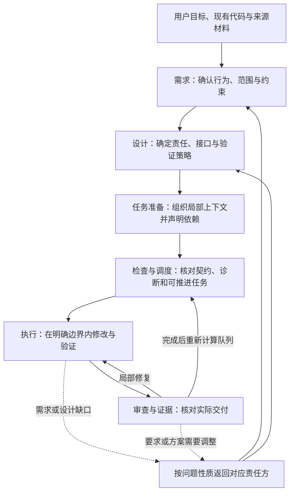

# 02. FlowForge 的整体设计：从有效结论到可验证交付

[背景篇](01-background-and-principles.md)提出的核心问题是：复杂需求的每一步，如何获得充分、适用的上下文，并把有效结论传给下一步。

FlowForge 的总体方案是把这项工作纳入工程流程：**讨论中持续维护有效结论，执行前整理任务所需的信息，通过依赖图确定推进顺序，再把实际结果作为证据交还给后续工作。**它由工程 Skill、Markdown 工件和 Go CLI 共同支撑。[1]

## 1. 先把决定保存下来，再组织局部执行

FlowForge 将内容分为四种职责，分别回答工作中的不同问题。[2]

| 内容职责 | 回答的问题 | 保存的主要含义 |
|---|---|---|
| Requirement：需求 | 为什么做，什么结果才符合目标？ | 可观察行为、范围、场景、约束和未决需求问题 |
| Design：方案设计 | 如何实现已经确认的要求？ | 模块责任、接口、信息流、迁移和验证策略 |
| Ticket：执行任务 | 本次具体交付什么，如何完成和验证？ | 局部设计上下文、修改位置、动作、适用约束与验证方法 |
| Evidence：交付证据 | 实际做成了什么，依据是什么？ | 交付行为、验证结果、审查处置、偏差和实现引用 |

这里的“权威”指某类含义由哪个位置维护。例如，需求负责定义导出权限的业务边界，设计负责确定权限如何进入后台任务。它不表示文档天然正确；含义仍需由人与 Agent 确认和维护。

这种分工使后续工作能够区分：哪些是要求、哪些是实现决定、哪些是准备执行的动作、哪些已经得到验证。执行者发现设计缺口时，应返回设计环节处理；不能为了完成任务，直接改写原需求。

四种职责也不等于每次必须建立四份文件。小型、已明确的工作可以在一张紧凑任务中承载所需内容；跨任务共享、需要独立讨论或长期维护时，再形成独立文档。[2]

## 2. 一项需求如何进入交付循环

整体过程可以用下面的信息流理解：

这是信息与责任的连接方式，并非所有工作都要整批完成一个阶段后才能进入下一个阶段。已经明确、没有相关阻塞的局部工作可以推进，其他区域的未决问题则保持可见。

### 讨论形成当前有效结论

人在协作中提供目标、确认范围和作出必要取舍；Agent 通过代码调查、材料分析和对话形成可核对的需求与设计。Skill 要求将已确认含义持续写入对应工件，而非只留在聊天中。旧文档和调查结果先作为来源材料处理，不直接成为现行要求。[3]

### 任务准备把全局结论转成局部依据

Plan 根据已明确的需求与设计形成可独立验证的交付增量，写明执行位置、动作、约束和验证方法。适用规范在前序环节识别和明确，再转录进任务；执行细节需要结合仓库事实补齐，不能把有标题的骨架当成充分契约。[4]

这一步承担了用户原本可能期望执行 Agent 临场完成的信息整理：从需求、设计和规范中挑出当前工作需要的含义，并把它们连接到具体修改与验证。

### 依赖与检查决定当前如何推进

Agent 声明真实的阻塞关系，CLI 检查工件与依赖，并计算可推进队列。任务进入执行前，还要核对当前依据和执行契约。图上没有阻塞，只回答了部分开工条件；未解决的契约缺项仍需处理。[5]

### 执行结果通过验证和审查返回流程

执行者按任务读取代码、实施并运行验证。实际结果与失败事实写入工件，审查再核对交付是否符合有效要求和适用规范。修复、需求调整和设计调整分别回到对应环节；完成证据为后续工作提供可检查的依据。[5]

因此，任务图会随着工作和修正继续更新。推进依赖当前文件与证据，不要求主会话始终记住整个项目的全部进展。

## 3. Skill、Markdown 与 CLI 为什么这样分工

这三个部分分别承担语义判断、信息保存和确定性计算，彼此不能互相替代。

| 组成部分 | 核心职责 | 在协作中的作用 |
|---|---|---|
| Skill | 指导 Agent 如何分析、形成工件、交接和处理缺口 | 明确当前该解决什么问题，什么情况需要返回前序责任方 |
| Markdown 工件 | 保存可阅读、可修改的结论、任务与证据 | 让信息跨会话存在，并允许人检查和版本管理 |
| CLI | 解析声明，检查关系并计算依赖队列 | 让循环依赖、缺失引用等可计算问题不依赖临场推断 |

Skill 是执行方法与约定，实际阅读、判断和写入仍由 Agent 完成；它不是独立运行的业务推理程序。Markdown 正文承载人的可读含义，元数据和链接辅助追踪来源、修订与依赖。CLI 根据这些声明进行检查，不通过命令行接收大段需求或设计正文。[1][2]

例如，“导出权限应与页面一致”是否完整表达用户意图，需要人和 Agent 理解；某个任务引用的设计是否存在、消费版本是否落后，则可以由程序检查。CLI 能提示复核，不能自动判断版本变化对业务的全部影响。

Agent 宿主提供模型请求、工具执行、子代理与权限控制等运行能力。FlowForge 可以部署角色和相关资产来配合宿主，但流程中的文字约定、CLI 检查和宿主强制限制是不同层次。具体配置与能力边界见[执行与协作](06-execution-and-collaboration.md)。

## 4. 全局依据与任务上下文如何保持联系

全局文档保存共享结论，任务保存当前增量所需的局部含义，并链接回来源。下游记录所依据的修订，供上游变化后复核。[2]

假设要实现一个数据导出功能，整个信息链应当承接同一条权限要求：

| 位置 | 承接的内容 |
|---|---|
| 需求 | 导出结果不能超出请求者通过页面查询可访问的数据范围 |
| 设计 | 明确后台任务如何携带和应用请求者的权限范围，以及怎样验证一致性 |
| 相关任务 | 写入本次必须实现的权限边界、接口依据、修改位置和越权场景验证 |
| 证据与审查 | 记录实际运行的检查、观察到的结果及对照有效要求的结论 |

同一要求在不同环节有不同表达：需求定义行为，设计解释实现，任务提供局部动作，证据说明实际结果。需要保留的是含义与追溯关系，而非把整份上游文档复制到每张任务中。

任务因此成为执行的主要入口。当前 Implement 约定仍要求读取项目不变量、链接的需求设计与相关代码。[5]这里的目标是减少无边界搜索和重新解释，并让必要的补读有明确方向。

同样，新执行上下文可以从任务和关联工件恢复工作，但这取决于材料准备与实际读取。每票一个执行上下文是组织工作的约定，不构成自动继承或正确执行的保证。

## 5. 这套设计承担的代价与边界

FlowForge 把一部分信息准备工作前移，因此产生了需求维护、任务整理、事实核实和审查成本。共享结论变化后，局部任务也需要复核。范围很小的工作应采用紧凑工件，避免形式上的拆分增加维护负担。

另一方面，程序检查只能覆盖已声明、可识别的关系与结构。需求遗漏、错误设计、漏声明依赖，以及证据是否足以证明交付，仍然需要语义判断。图上独立的任务也不一定能安全地同时写入同一批文件。

FlowForge 的整体收益、成本和正确率尚无系统性实测结果。效果需要结合需求遗漏、补读与返工、验证质量及整体成本评估，文档齐全或检查通过不能证明正确率更高或成本更低。背景篇引用的外部研究解释了上下文使用的困难，不构成 FlowForge 的效果验证。

## 各环节详解

- [需求与设计管理](03-requirements-and-design.md)：如何形成、维护和更新有效结论。
- [任务上下文](04-task-context.md)：如何把需求、设计和适用规范交给当前任务。
- [依赖与推进](05-dependencies-and-progress.md)：如何根据关系和诊断确定下一步。
- [执行与协作](06-execution-and-collaboration.md)：如何分配角色、组织上下文和运行环境。
- [验证与反馈](07-verification-and-feedback.md)：如何证明交付、保存失败事实并收敛修复。

## 仓库依据

1. [架构与权威模型](../architecture.md)：组成部分、职责分工与工件形态。
2. [共享工件契约](../../assets/skills/_shared/ARTIFACT-CONTRACT.md)：内容职责、局部交接、来源关系和执行审查循环。
3. [Align](../../assets/skills/flowforge-align/SKILL.md) 与 [Solution Design](../../assets/skills/flowforge-solution-design/SKILL.md)：需求与设计的形成、维护和交接职责。
4. [Plan](../../assets/skills/flowforge-plan/SKILL.md)：任务增量、规范转录、执行细节准备与图发布。
5. [Implement](../../assets/skills/flowforge-implement/SKILL.md) 与 [CLI 行为](../cli-design.md)：执行前检查、验证证据和确定性计算的边界。

[上一篇：背景与原理](01-background-and-principles.md) · [返回目录](README.md) · [下一篇：需求与设计管理](03-requirements-and-design.md)
