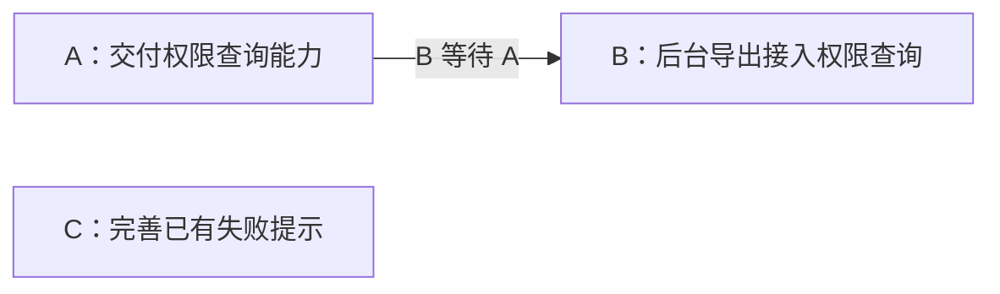

# 05. 依赖与推进：让下一步由当前事实确定

任务已经具备局部执行依据后，还需要回答：现在应当推进哪些任务，哪些必须等待，发生变化后如何重新安排？FlowForge 将真实的阻塞关系写进任务，通过 CLI 检查图与工件，再计算当前的执行候选。

这样，推进顺序有了可重复计算的依据。Agent 负责说明任务之间为什么存在依赖，程序负责根据已声明的关系和状态计算；两者的分工决定了这套机制能发现什么、不能发现什么。

## 1. 依赖表示开工条件，而不是阅读顺序

任务通过 `Blocked by` 声明前置任务。声明一条边，意味着前置工作尚未结束时，当前任务不能按既定约定开始。[1]

不是所有联系都应当成为阻塞边：

| 关系 | 应如何表达 |
|---|---|
| 当前任务需要前置任务交付的接口或能力 | 声明真实阻塞依赖 |
| 两项任务引用同一设计或需求 | 通过来源链接与消费关系表达，不因此互相阻塞 |
| 团队偏好先做其中一项 | 属于调度选择，不自动构成技术依赖 |
| 两项任务会修改同一文件 | 需要协调写入或隔离，不能仅靠图上无依赖认定可并行 |

继续使用数据导出场景，假设已经明确三个可独立验证的增量：A 提供后台任务可用的权限查询能力，B 将它接入导出流程，C 改善已有导出结果页的失败提示。在这个示例的约定下，B 必须等待 A，C 可以独立开始。

图中的箭头表示交付先后关系；B 的任务正文记录它被 A 阻塞。C 能独立推进是示例前提，不是从任务名称自动得出的结论。实际规划必须核对接口、代码和验证条件。

只保留真实依赖，可以避免为了形成整齐的阶段，把全部任务串成一条长链。DAG 即有向无环图：如果 A 等 B、B 又等 A，双方都无法推进，必须重新判断切分或关系，而不是让执行者临场绕过。[2]

## 2. `check` 核对有效性，`frontier` 展示当前候选

两个命令使用当前工件，但回答的问题不同。

| 命令 | 主要回答什么 | 应怎样理解结果 |
|---|---|---|
| `check` | 依赖与工件关系是否满足所选检查策略？ | 查看图错误、诊断及有效性结果，不能只看一句“通过” |
| `frontier` | 按当前状态、依赖和内容诊断，任务分别处于什么情况？ | 区分正常候选、带警告候选、gap、已领取和被阻塞任务 |

`check` 明确检查自我阻塞、引用不存在的前置任务，以及循环依赖；还结合工件目录中的元数据、权威引用、未决项和证据等诊断判断有效性。[2][3]

`frontier` 先根据任务生命周期与前置任务状态计算图上的候选，再用内容诊断分组和筛选。[4]因此，一个任务可能没有未结束的前置任务，却因为执行契约缺项或规范准备未完成而不能直接派发。

实际推进需要同时考虑两类结果：图与声明是否有效，以及当前哪项工作满足派发和开工要求。`frontier` 不能代替 `check` 的完整图验证，`check` 通过也不能说明所有任务都已可执行。

## 3. 诊断怎样影响推进

FlowForge 区分 warning、gap 和 blocker，目的是表达不同性质的风险与缺口，而不是把所有问题都简化成“整个提案没准备好”。[5]

| 类别 | 含义与例子 | 当前默认处理 |
|---|---|---|
| warning | 需要关注或复核的事实，例如消费的上游修订落后 | 通常允许进入带警告候选，风险仍需处理 |
| gap | 缺少必要决定或执行依据，例如执行契约不完整 | 单独列出，默认不进入有效候选集合 |
| blocker | 实际阻止推进的条件，例如某些强制内容要求缺失 | 从有效候选中排除 |

这里说的是一般策略，具体诊断可能有更严格的规则。例如，`standards-pending` 在诊断中是 warning，但当前 frontier 实现会将对应任务归为内容阻塞，避免把尚未完成规范转录的任务交给执行者。[4]

### 检查策略与候选选择不是同一个开关

当前 `check` 默认把图错误和未豁免 blocker 视为失败；warning 和 gap 仍会报告，但不一定使默认检查失败。使用 `--strict` 时，未豁免 warning 和 gap 也会使检查失败。[3]

对于 frontier 的有效候选选择，默认包含正常任务与通常的带警告任务，`--strict` 只选择正常任务；`--include-gaps` 可以纳入带 gap 的任务，但不会让诊断消失，也不能解除真实依赖或内容阻塞。严格模式优先，不会因为同时指定包含 gap 就将其加入。[4]

输出还可能保留不同分组供观察，不能把“显示在结果中”当作“已获准开工”。上一篇介绍的执行契约检查仍然适用：任务即使通过 `--include-gaps` 被选入，也不能绕过 Implement 对 `execution-contract-incomplete` 的停止要求。[6]

### 局部影响与全局有效性需要分开看

需求或设计中的未决项可以声明影响哪些任务或语义区域。Catalog 根据这些声明，把相应诊断关联到受影响的消费者。[5]例如，下载链接有效期未定，如果确实只影响下载访问任务，就应明确这个范围；不能用一个模糊的“设计未完成”覆盖所有工作。

但局部归类不意味着任何命令都忽略其他问题。`--feature` 主要用于缩小结果展示，计算仍以发现范围内的全局图和诊断为基础，跨提案依赖会保留。`check` 的全局有效性、frontier 的全局诊断策略仍可能使命令失败，即使聚焦视图中存在正常候选。[3][4]

因此，局部工作能否继续，需要结合具体诊断、调用策略和执行约定判断。范围筛选不能用来隐藏全局错误。

## 4. 豁免保留处置理由，不改变原始事实

有些诊断可能需要有理由地接受。FlowForge 的持久 waiver 要求指向准确的诊断与目标，并记录原因；不能使用一个通配声明跳过所有问题。[5]

程序应用豁免后，会保留原诊断及处置理由，在相应策略判断中不再按未豁免诊断处理。找不到匹配诊断的豁免本身也会产生提示，提醒维护者检查它是否已过时。

这并不意味着缺失的接口已经实现、前置任务已经完成，或执行者获得了擅自改变要求的权限。豁免处理的是某项诊断的处置；任务实际交付边界、图依赖和不可绕过的执行要求仍需分别满足。谁有权接受风险，也需要按项目和有效要求的责任约定处理。

## 5. 完成、变更与修复后重新计算

frontier 是根据当前文件计算的结果，不是一份生成后永久有效的排期。A 完成后，B 的依赖条件可能解除；某项设计改变后，原本可推进的任务可能需要复核；新增修复任务也可能改变下游的阻塞关系。

一个常见推进过程是：

1. 根据当前工件运行检查，处理影响推进的图错误与诊断。
2. 查看 frontier，确定候选及其依据，再完成执行前核对。
3. 执行后记录验证、审查和实际结果，按约定更新任务生命周期。
4. 如果出现修复或上游调整，更新相应工件与依赖，再重新计算。

当前图计算读取任务的生命周期状态。已领取任务单独列出；前置任务是否仍阻塞，按模型定义的终态判断。[2]这使程序能稳定计算，也意味着状态必须忠实反映已经完成的处置。

终态包括关闭、解决和不再处理等情况，不能仅凭“进入终态”推断依赖能力已经交付。如果前置工作决定不做，而下游仍然依赖它，就需要调整下游范围或关系，不能只改状态来释放队列。图本身不会判断“不做”是否满足原来的业务前提。

同样，不需要另造 `design-ready` 或 `execution-ready` 之类持久质量标签来表达就绪。当前能否推进，由生命周期、依赖、内容与相关诊断共同推导；具体修复流程见[验证与反馈](07-verification-and-feedback.md)。

## 6. 队列提供依据，执行安排仍需要判断

这套机制把声明后的依赖检查与候选计算交给程序，但仍有几类事情需要人和 Agent 处理：

- **依赖是否声明完整。**没有记录的接口前置条件不会自然出现在图里。
- **任务内容是否正确。**关系有效不证明需求、设计或执行事实准确。
- **任务是否适合同时执行。**图上独立不代表文件写入、测试资源或运行环境没有冲突。
- **候选中优先做什么。**frontier 的列表不是业务价值、风险或工期优化后的排程。

因此，DAG 和诊断为“现在可以考虑推进什么、为什么不能推进”提供明确依据，角色选择、模型配置和安全并发则属于下一层执行安排。下一篇将讨论这些任务如何交给执行者，以及上下文和结果如何交接。

## 仓库依据

1. [Plan](../../assets/skills/flowforge-plan/SKILL.md)：真实阻塞关系与可独立验证的任务增量。
2. [DAG 实现](../../internal/tracker/dag.go)与[生命周期模型](../../internal/tracker/model.go)：图检查、前置条件和候选计算。
3. [Check 命令](../../internal/command/check.go)：有效性、严格策略和展示范围。
4. [Frontier 命令](../../internal/command/frontier.go)：诊断分组、有效候选选择和全局策略。
5. [共享工件契约](../../assets/skills/_shared/ARTIFACT-CONTRACT.md)与[语义诊断实现](../../internal/tracker/catalog_semantics.go)：未决项作用范围与精确豁免。
6. [Implement](../../assets/skills/flowforge-implement/SKILL.md)：执行前检查及不可绕过的契约要求。

[上一篇：任务上下文](04-task-context.md) · [返回目录](README.md) · [下一篇：执行与协作](06-execution-and-collaboration.md)
