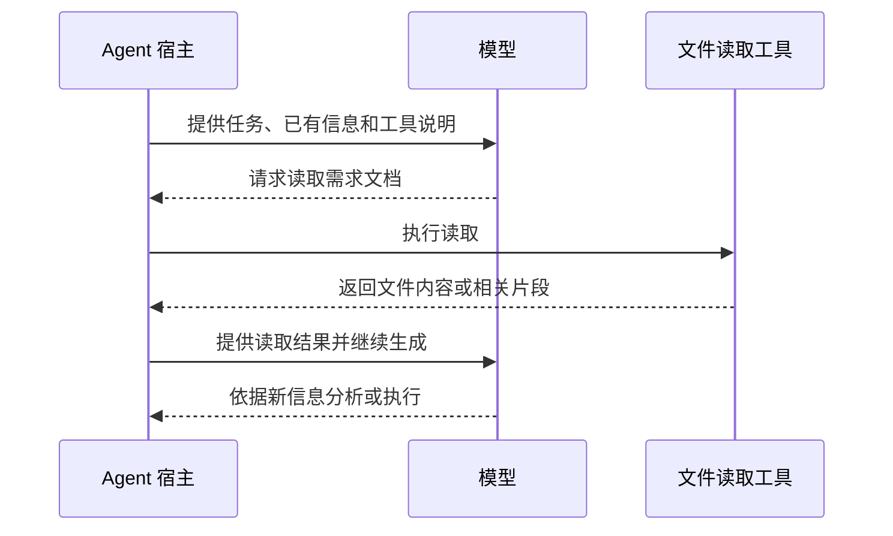

# 01. Context 是什么：模型当前能够依据哪些信息作答

> 状态：正文初稿，供讨论完善。

人与 Agent 协作时，很容易把“我们之前讨论过”“需求已经写进文档”和“Agent 当前知道这条需求”看作同一件事。理解 Context，需要先把这三个状态区分开。

**Context（上下文）是模型在当前生成过程中可以依据的信息。**在工程 Agent 中，这些信息可能来自指令、历史对话、当前任务、工具说明、已读取的代码与文档，以及工具返回的运行结果。哪些内容被提供给模型，由 Agent 宿主、应用程序和模型服务共同组织。

理解 FlowForge 的问题设定，可以从一个基本区别开始：**信息已经被保存，不等于信息已经进入当前 Context；进入 Context，也不等于一定会被正确使用。**本篇解释前半部分，下一篇再讨论后半部分。

## 1. 模型知识、当前上下文与外部存储

一个编码 Agent 看起来像一个持续工作、能够记住项目情况的协作者。实际理解它的工作方式时，至少需要区分三个层面。

| 层面 | 保存或提供什么 | 在工程任务中的作用 |
|---|---|---|
| 模型训练中形成的知识与能力 | 编程语言、常见模式、推理与生成能力等，体现在模型参数中 | 帮助理解问题和生成方案；不能据此假定它知道当前仓库的具体要求 |
| 当前请求中的 Context | 本次生成可依据的指令、消息、材料和工具结果等 | 为当前判断提供任务事实、约束与反馈 |
| 外部存储与会话状态 | 仓库文件、数据库、聊天记录、宿主记忆、服务端会话等 | 保存可供后续恢复和取用的信息，具体使用方式由系统安排 |

例如，模型可能掌握重试和幂等的通用知识。但当前项目规定“永久性错误不重试”，这一条是项目要求。它需要通过当前输入、历史状态或文档读取等方式被提供，不能依靠通用知识推导出这是本项目已经确认的决定。

同样，一次普通对话中的新决定不会因此自动成为模型参数里稳定保存的项目知识。在 Agent 产品中看到的“记住了”，往往需要结合会话历史、记忆文件或其他外部状态来理解。[1][2]

本 Wiki 把承载 Agent 工作循环的工具或应用称为 **Agent 宿主**。它通常负责组织请求、执行工具、保存历史和管理会话；部分状态管理也可以交给模型服务。模型负责依据所获信息生成回答或工具调用请求。两者共同形成我们实际使用的 Agent。

## 2. 一次 Context 中有哪些内容

用户在聊天框里输入的消息，只是上下文的一部分。一次工程任务的 Context 通常还包含以下内容，具体组织方式因宿主和 API 而异。

| 信息来源 | 典型内容 | 提供的作用 |
|---|---|---|
| 系统与应用指令 | 角色、工具使用规则、工作边界 | 约束工作方式 |
| 当前用户请求 | 本轮目标、补充信息、修正意见 | 确定当前要做什么 |
| 被保留的历史与摘要 | 前几轮对话、工具调用记录、压缩后的交接说明 | 延续工作状态 |
| 工具定义 | 可调用工具、参数、使用说明 | 说明能够如何获取信息或采取行动 |
| 已读取的任务材料 | 需求条款、设计片段、代码、适用规范 | 提供具体事实与约束 |
| 工具结果 | 搜索结果、文件内容、测试输出、截图 | 提供观察与反馈 |

这些内容具有不同角色与可信程度，不能简单当作一段没有区别的正文。模型服务还可能加入应用没有直接展示的信息。这里列出的是理解工程工作所需的概念组成，不代表每个宿主都采用相同的消息格式。

Context 也不只包含可见文字。支持多模态的模型可以接收图片等输入；一些模型还涉及推理 token 或延续状态，其预算和保留方式需要按具体 API 说明理解。[2][3]

因此，聊天界面显示的长度无法直接代表模型当前承载的信息量。一次文件读取或测试输出，就可能引入大量新内容；未显示在聊天正文中的工具说明同样可能占用上下文。[2][4]

## 3. Token 与 Context Window 表示什么

模型处理文本时，会把文字转换成 token。一个 token 可能对应字符、词的一部分、完整词或标点；切分方式受模型编码、语言和文本内容影响。因此，token 数不能直接等同于字数，也不适合用固定的中文或英文换算比例估算所有请求。[4]

**Context Window（上下文窗口）描述模型一次请求能够处理的容量上限。**它通常以 token 表示。模型还可能有独立的最大输出限制，所以输入材料需要与本次生成共同考虑；推理模型也要按其文档预留相应预算。[1][2]

例如，一个请求可以在概念上理解为：

```text
本次容量需求
  = 输入信息占用
  + 本次生成占用

输入信息占用
  = 指令与工具说明
  + 保留的历史或摘要
  + 当前任务与已加载材料
  + 工具结果等其他输入
```

这是一种预算思路，不是所有 API 的精确计量公式。推理 token、图片及其他内容如何计入，历史推理是否保留，都应以所用模型和接口为准。[1][2][4]

窗口有限意味着，系统需要安排哪些信息继续保留、哪些信息稍后再读，以及为生成结果留下多少空间。接近或超过限制时，系统可能拒绝请求、截断部分内容，或通过压缩、清理等机制继续工作；这些行为由具体模型服务和宿主决定，不能假设所有 Agent 都会自动完整保留历史。[2]

至于“容量还够时，信息是否就能被可靠使用”，这是另一层问题，将在[第二篇：有效上下文](02-effective-context.md)中展开。

## 4. 多轮对话如何产生“记忆”

用户看到的是一个连续会话，模型参与的则是连续的生成请求。前一轮的信息需要以某种形式进入后续生成，才可能继续影响结果。

常见做法包括：应用把先前消息与新问题一起提交；通过服务端会话对象或前一响应标识延续状态；或者用摘要及其他状态替代部分历史。OpenAI 的官方文档同时说明了手工传递历史、Conversations 和 `previous_response_id` 等方式。[1]

所以，“每次都是新请求”不意味着用户每轮都必须重讲一遍。系统可以替用户管理状态。关键在于：**下一次生成能依据什么，取决于系统实际提供或恢复了什么。**服务端保存历史，也不能推导出无限容量或永久保持每条原文。

当历史持续增长时，压缩是一种常见管理方式。它把部分早期内容整理成更短的表示，使后续请求有空间继续工作。摘要会选择保留哪些含义，不能默认它等同于原始讨论的全部细节。具体压缩策略、触发条件及可保留内容因系统而异；Agent 的完整管理循环将在[第三篇](03-agent-context-processing.md)展开。[2]

## 5. 文件中的信息如何进入 Context

假设需求文档中保存了这样一条已经确认的要求：

> 仅对暂时性错误重试，永久性错误立即结束。

它在协作过程中可能处于几个不同状态：

| 状态 | 当前可以依赖什么 |
|---|---|
| 要求存在于早期对话中 | 如果相关历史或其有效摘要被提供给当前生成，模型可以依据它 |
| 要求已经写入仓库文件 | 系统有了持久来源，但还要安排读取、检索或注入 |
| Agent 只获得文件路径 | 获得了定位线索，尚不能据此认为已取得文件正文 |
| 工具读取了相关条款，结果进入后续请求 | 模型获得了该要求的具体内容，可以将其用于当前任务 |
| 文件后来发生修改 | 之前读取的内容不会因此自然变成新版本，需要重新读取或核对 |

一次典型的文件读取过程如下：



这个过程与官方 function calling 文档说明的“请求工具调用 → 应用执行 → 将结果提供给后续请求”一致。[3]宿主也可以预先读取并注入材料，检索服务可以只返回相关片段；不要求每次都由模型显式发起文件读取。

这里决定信息可用性的，是**内容通过什么路径进入当前工作**。要求如果只在未读取的文件里、没有命中的检索结果里，或未提供给当前请求的历史中，就不能据此断言模型已经具备它。即使内容被提供了，是否正确理解并执行，还需要另外验证。

## 6. 这对复杂项目意味着什么

复杂需求的分析、设计和实施会不断产生新信息：确认的边界、接口约定、代码事实、项目规范和验证结果。它们既需要被保存，也需要在后续适当的步骤被准确提供。

前面的区分使我们能够分别提出三个问题：

- **保存：**哪些结论需要离开聊天记录，成为可持续维护的信息？
- **取用：**下一步需要哪些内容，由谁定位、选择并提供？
- **核对：**提供的内容是否适用、是否仍是当前版本，执行结果是否符合它？

这正是后续分析 FlowForge 的起点。需求落盘解决了持久来源的一部分问题，任务级上下文则进一步处理如何把相关信息交给当前工作。具体方案将在问题篇和功能篇展开。

本篇先建立信息从哪里来、如何进入当前 Context 的基本认识。下一篇[有效上下文：容量与可靠使用信息的能力](02-effective-context.md)继续讨论：即使内容仍在窗口内，为什么还需要关注相关性、干扰、信息组织与任务难度。

## 参考资料

以下为原理说明所依据的官方资料，查阅日期：2026-10-26。具体模型和 API 规则可能更新；本文使用其一般机制，不固定窗口大小或产品阈值。

1. [OpenAI · Conversation state](https://platform.openai.com/docs/guides/conversation-state)：独立请求、手工传递历史、服务端会话与响应延续方式，以及上下文预算。
2. [Anthropic · Context windows](https://platform.claude.com/docs/en/build-with-claude/context-windows)：工作上下文与训练知识的区别、输入组成、生成预算和压缩管理。
3. [OpenAI · Function calling](https://platform.openai.com/docs/guides/function-calling)：工具调用、应用执行与工具结果进入后续请求的流程。
4. [OpenAI · What are tokens and how to count them?](https://help.openai.com/en/articles/4936856-what-are-tokens-and-how-to-count-them)：token 切分、输入输出类别与完整请求计量。

[返回 Wiki 目录](../README.md) · [下一篇：有效上下文](02-effective-context.md)
