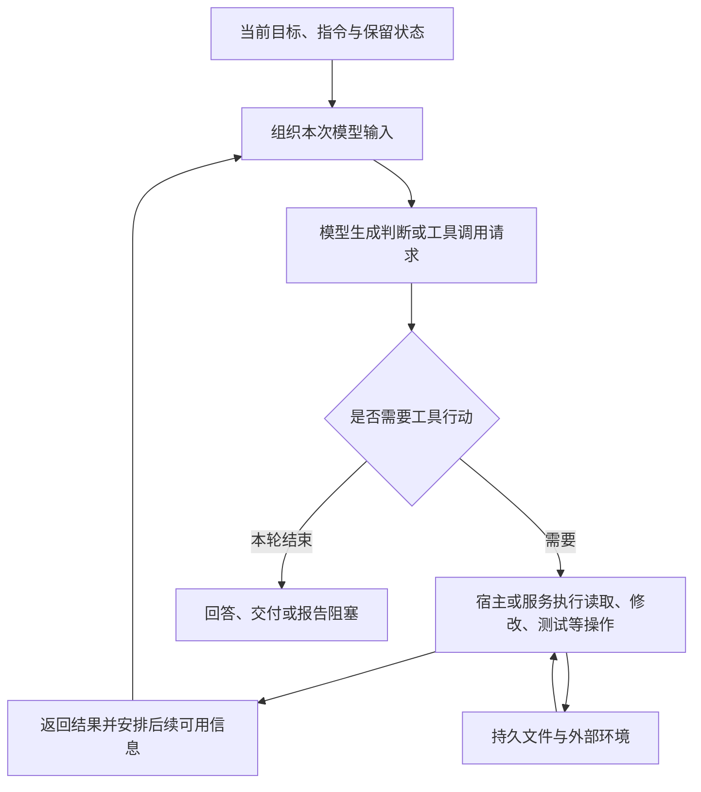

# 03. Agent 如何组织 Context：读取、行动、压缩与恢复

> 状态：正文初稿，供讨论完善。

前两篇分别说明了信息如何进入 Context，以及容量为什么不能代表信息使用的可靠程度。实际的工程 Agent 还需要处理时间上的变化：任务不断推进，文件被修改，工具产生新结果，早期历史则可能被压缩或清理。

**Agent 的上下文是随着工作循环持续组织的。**每一次读取、行动和结果回传，都会影响下一次生成可依据的信息。理解这个过程，才能判断一条需求为何没有被使用，以及新会话如何继续已有工作。

## 1. 一项任务包含多次生成与外部行动

以“为消息发送增加受控重试”为例，Agent 通常不会只生成一段答案就完成。它可能先读取需求与代码，再修改实现、运行测试，根据错误继续调整。

在使用应用侧工具的典型循环中，模型生成工具调用请求，宿主执行工具，再将结果提供给后续生成。OpenAI 的 function calling 文档明确描述了这条链路。[1]某些工具也可以由模型服务执行，具体调用过程和消息形式会有所不同。



这张图表达的是信息流，不要求每个宿主都按相同方式拼接消息，也不代表系统每一步都重新读取全部文件。

需要特别区分两类变化：工具改变了外部世界，以及模型获得了关于变化的信息。写入工具可能已修改代码，但模型是否收到成功结果、测试是否运行、结果是否进入后续输入，还要分别核对。工具调用请求本身只能说明尝试采取行动，不能证明预期行为已经交付。

## 2. 读取、修改和验证分别带来了什么信息

下面的过程继续使用消息重试示例。它是工作方式的示意，不是某个宿主的固定执行记录。

| 步骤 | 外部发生的事 | 后续生成需要获得的信息 |
|---|---|---|
| 读取需求 | 工具访问当前需求文档 | 暂时错误、永久错误与幂等要求等适用条款 |
| 查找代码 | 搜索相关文件和符号 | 位置坐标，以及判断职责所需的代码内容 |
| 修改实现 | 文件发生变化 | 修改是否成功、具体修改范围；必要时复读结果 |
| 运行测试 | 测试进程在某版代码上执行 | 命令、退出状态、相关输出与测试覆盖范围 |
| 根据反馈调整 | 新修改替换了部分旧实现 | 哪些结果已不再适用于当前版本，哪些检查需要重跑 |

搜索结果只提供文件名时，Agent 获得的是坐标；返回相关实现时，才获得相应代码事实。同样，“测试通过”需要结合具体命令与测试范围理解，不能推导成全部需求都已验证。

这些区别说明，工具反馈应当保留支持下一步判断所需的证据。只返回“失败”可能不足以定位问题，返回整份巨大日志又会增加负担。怎样在保留必要事实的同时控制输出量，是上下文组织的一部分。[4]

## 3. 下一次生成的输入如何形成

一次工具操作结束后，系统需要决定继续提供哪些历史、加入哪些新结果，以及是否加载额外材料。可以用下面的概念关系理解：

```text
下一次生成可依据的信息
  ← 继续适用的目标与指令
  ← 被保留或恢复的历史状态
  ← 本轮新增消息与工具结果
  ← 为当前步骤补充的材料
```

这里没有假定输入一定单调增长。宿主可以追加原始结果，也可以筛选片段、清理旧结果或替换部分历史。服务端会话机制也可以承担一部分状态管理。

模型可能根据当前信息决定接下来读哪个文件，但这种选择也依赖它已经掌握的入口：任务目标是否具体、路径是否明确、来源是否可定位。知道需要遵守“项目规范”，与知道本次适用的规范及条款，并不是同样充分的输入。

所以，Agent 能够自主读取不意味着上下文会自动组织完整。系统仍需要提供足够的导航、相关材料与停止条件，使缺少信息时可以补读、核对或报告问题。

## 4. 压缩、清理与截断有什么区别

当工作历史不断累积时，系统需要管理容量。以下操作都可能减少输入，但它们保留信息的方式不同。

| 操作 | 如何处理原内容 | 后续需要注意什么 |
|---|---|---|
| 摘要压缩 | 用较短的摘要或压缩表示替换部分历史，有些方式保留近期原文 | 后续依据替代表示工作，不能默认所有细节都原样保留 |
| 工具结果清理 | 移除选定的旧结果，可能保留调用记录或移除提示 | 知道曾读取过，不等于仍持有读取内容 |
| 截断或裁剪 | 省略部分消息、内容或过长输出 | 未保留部分可能没有任何语义替代，需要按来源补读 |
| 按需加载 | 本次只提供相关片段，其他内容留在外部 | 需要明确定位入口，必要时继续读取 |

Anthropic 的 compaction 文档描述了用摘要替换较早对话的方式，并区分由应用控制或按阈值触发等安排。[2]其 context editing 文档则说明，工具结果清理可以移除旧结果并加入占位文本。[3]这些是具体 API 的机制示例，不能假定所有宿主都具备相同功能或策略。

摘要压缩尤其需要选择：哪些结论与当前工作有关，哪些失败尝试值得保留，哪些背景可以省略。摘要可以很有用，但其目标是支持继续工作，而不是保证原始对话的每个细节都可恢复。

例如，原讨论明确区分暂时性和永久性错误，摘要却只剩“已确认增加重试”，那么两者含义就不等价。这个例子说明一种遗漏风险，不代表压缩一定会遗漏这条要求。

因此，重要决定应当有可核对的持久来源；摘要中保留目标、有效结论、当前状态和来源坐标，可以帮助继续工作。后续仍需根据当前任务恢复必要内容，而不是只相信“之前已经读过”。

## 5. 新会话、恢复会话与子代理分别继承什么

“继续原会话”“恢复保存的会话”和“交给另一个 Agent”看起来都在延续工作，但它们的信息起点可能不同。

| 场景 | 输入可能来自哪里 | 不能默认什么 |
|---|---|---|
| 当前会话继续 | 原始历史、保留结果、摘要及新增消息 | 不能默认所有早期原文一直保留 |
| 恢复已保存会话 | 宿主保存的消息、服务端状态、压缩表示等 | 不能仅凭恢复成功认定旧代码事实仍适用 |
| 开启新会话 | 用户输入、项目指令、显式交接和重新读取的材料 | 不能默认它知道先前讨论的全部决定 |
| 派发子代理 | 任务说明、宿主注入内容，以及可能的继承、摘要或文件引用 | 不能默认它具有主会话的全部 Context，也不能默认完全没有继承 |

这里列的是需要核对的来源，具体继承策略由宿主和调度方式决定。有的系统给子代理独立窗口并只返回摘要，有的支持复制或继承部分状态；这些都不会自然形成多个 Agent 之间随时同步的完整工作记忆。[4]

即使主代理和子代理访问同一个仓库，它们当前输入中的代码快照也可能不同。一个代理改了文件，另一个此前读到的内容仍可能是旧版。需要时应重新读取或核对实现引用，而不能把共享文件系统理解成共享实时 Context。

对于持续任务，交接至少要使接手者能定位当前目标、有效约束、实际进展、已运行验证、未解决问题与下一步。持久文档提供恢复入口，接手者仍要加载适用内容并检查现状。重新读取也有成本，因此应围绕当前工作组织入口，而不是每次重复加载全部历史。[4]

## 6. Agent “忘了”时，应区分哪些情况

需求没有被落实，表面上都可以叫“忘了”。但修正方式取决于信息在哪一步出了问题。

| 情况 | 可以核查的线索 | 应处理的方向 |
|---|---|---|
| 从未读取或注入 | 当前材料里只有文档路径，没有相关正文或有效摘要 | 补充来源与必要内容 |
| 输出被截断或片段未命中 | 工具显示截断，或读取范围没有覆盖条款 | 调整读取范围、按需补读 |
| 历史已被摘要或清理 | 原文存在于旧记录，当前保留内容缺少该含义 | 从持久来源恢复并修正后续输入 |
| 内容已过时或冲突 | 输入包含旧接口、相互矛盾的决定或不明版本 | 核对有效来源与当前状态 |
| 已提供但未正确使用 | 当前输入包含适用要求，交付仍然违反它 | 检查理解、执行与验证，参见第二篇 |

这些原因可能同时存在。只有在能观察实际输入、读取范围或压缩记录时，才容易进一步区分；无法观察时，应保留不确定性，不能从一次错误直接断言模型没有读取或必然因为压缩遗漏。

## 7. 对 FlowForge 问题设定的启示

上下文管理贯穿工作全过程。需求讨论产生结论，设计消费这些结论，执行读取任务与代码，验证产生新证据，交接再把实际状态传给下一步。每个环节都需要选择、保存、提供和核对信息。

这使 FlowForge 的核心问题更加具体：如何让复杂需求的每一步有明确的信息入口，并在行动、反馈与会话切换后保持有效结论可恢复。持久化、局部任务上下文与证据反馈分别处理这条链上的不同环节，它们的具体机制将在后续篇章展开。

[下一篇](04-precision-vs-recall-in-context.md)讨论如何选择当前步骤所需的信息：怎样兼顾相关、充分与有限，何时摘要、检索或补读，以及上下文准备本身的成本。

## 参考资料

查阅日期：2026-10-26。以下资料用于说明机制与工程实践；具体宿主行为、功能可用性和默认策略应以实际环境为准。

1. [OpenAI · Function calling](https://platform.openai.com/docs/guides/function-calling)：模型请求调用、应用执行与工具结果回传的工作循环。
2. [Anthropic · Compaction](https://platform.claude.com/docs/en/build-with-claude/compaction)：摘要替换早期对话，以及不同压缩管理方式。
3. [Anthropic · Context editing](https://platform.claude.com/docs/en/build-with-claude/context-editing)：工具结果清理、占位提示和其他上下文编辑策略。
4. [Anthropic · Effective context engineering for AI agents](https://www.anthropic.com/engineering/effective-context-engineering-for-ai-agents)：按需获取、工具反馈、压缩、持久笔记与多代理上下文组织。

[上一篇：有效上下文](02-effective-context.md) · [返回 Wiki 目录](../README.md) · [下一篇：精准上下文的取舍](04-precision-vs-recall-in-context.md)
