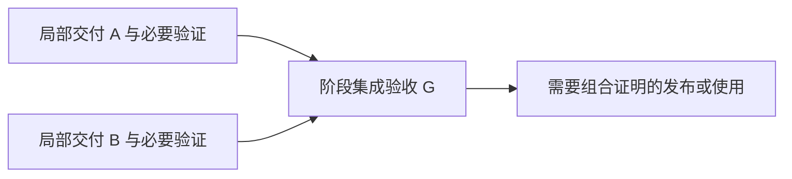

---
flowforge:
  schema: 1
  role: design
  id: cost-aware-verification-planning-design
  revision: 1
  consumes:
    requirements:
      cost-aware-verification-planning-requirements: 1
---

# 成本感知的验证规划与修复复验：设计

消费 [需求 revision 1](requirements.md#cost-aware-verification-planning-requirements)。本设计选择在现有 Markdown 契约与角色分工中明确验证安排，不新增 Issue Schema、CLI 签名、状态机或自动缓存平台。实施对象是技能及共享部署说明；CLI 保持结构校验职责。

## 方案选择

| 方案 | 能力与代价 | 裁决 |
| --- | --- | --- |
| 所有票/修复继续执行全部原验证 | 实现简单，但重复环境准备、完整回归和取证成本保留 | 不作为新票默认规划目标；旧票兼容保留 |
| 权威制定局部/阶段验证及 Fix 复验，执行者机械执行 | 用现有正文、证据和依赖即可表达；需同步更新技能的执行解释 | **采用** |
| 建立自动影响分析、证据缓存和新阶段状态 | 可进一步自动化，但需要新的失效模型和强制机制，当前事实不足 | 本轮不做 |
| 放宽实现者权限、自选测试或取消独立审查 | 破坏既有可靠性约束 | 按 R1 排除 |

采用方案的限制：成本和证据适用性仍由权威角色判断，CLI 不会自动证明它们；必须用受控执行验证规则遵从度，而非仅检查文件结构。

## 责任与批准边界

| 责任方 | 负责 | 不获得的权限 |
| --- | --- | --- |
| Solution Design | 确定局部/阶段验证接缝、何时需要真实环境和兼容策略 | 不代替需求方减少验收行为 |
| Plan | 将交付和验证分配到票，给出真正开始依赖、检查分组及重型动作理由 | 不把未知接口当作已验证事实，不绕过 Refine |
| Refine | 按现有五节核实命令、环境、成功/失败路径、反例及组覆盖 | 不另选设计或自行缩减交付 |
| 轻量 Implement | 只执行已发布的 Change 和本轮检查安排，保存实际结果 | 不自行分组、选测、复用证据、改预设测试或设计修复 |
| Review/裁决者 | 汇齐发现、给出机械 Fix 及复验安排，独立判定证据适用性 | 不通过复验安排改变验收标准、方法或架构；此类仍 design return/repair |
| 合法测试作者 | 在明确授权的 Change 中修改测试/fixture 并更新受影响基线 | 不为产品失败削弱断言，不把写保护绕过视为授权 |

Round 0、两个独立审查轴、原关闭责任和 substantive finding → repair 路由保留。角色职责澄清写入共享契约，相关技能只保留自身操作及引用，避免重复一整套规则。

## 局部交付与阶段集成

设计的验证策略包含一份紧凑的分配表：行为/关键风险、局部证明、阶段证明及触发条件。Plan 据此形成 Delivery、Done and verify 和真正的依赖边；Refine 在前置满足后核实精确运行事实，不提前填猜测。

- 局部票闭合自己承诺的契约；真实数据库、并发等如果是该承诺的必要观察条件，就不能被移到以后。
- 跨票组合由一个普通 `role: ticket` 的阶段验收票承担；与完整回归共用环境时可在同一受控运行中取证。
- 阶段验收票依赖需要组合的局部交付；需要完整证明的发布/实际使用票依赖该阶段验收。独立阶段可各自推进，不建立无关的批次汇合屏障。
- 局部票不再声明它未证明的端到端行为；此前合同已有此声明时，先由原权威修订，不能只删除命令。

此图是验证责任示意，不是本 proposal 已发布的实施票。若 B 真正依赖 A 的接口，再增加 A→B；不能为追求并行删掉真实依赖。

**门禁事实：**现有 DAG 将 `closed/resolved/wontfix` 都视为终态，不理解测试是否通过。因此，派发需要阶段证明的消费/发布票前，负责人必须确认 G 的正向验收结果适用于待使用版本，并已按原关闭规范独立审查。仅 `frontier` 返回 Ready 或 G 被标成 `wontfix` 不构成通过；条件不满足时不派发。豁免必须先由原权威正式重定范围，不允许轻量执行者解释终态。

**纯验证票的审查对象：**G 交付非空的实际验证记录/结果工件，列出所验实现固定点、可重现命令、结果及边界；审查同时取得关联实现的明确范围。不能向 Review 提交空 diff 或仅一句“已跑过”。证据文件是可审对象，关联代码证明其语义，不能只评证据格式。

**后续失效：**G 已通过后，新的 Fix 若使组合证明失效，负责人将受影响验收沿现有 repair 路径重新交付，并使尚未执行的消费/发布依赖新的有效证明。旧报告保留为历史，不能给新版本自动放行；已发生的发布不由本规则追溯抹去，其恢复策略仍由既有设计/运维权威处理。

## 检查安排：在现有正文中明示采用

在 `Done and verify` 内使用可选小节 `### Verification schedule` 表达本票的执行时机。它是**技能解释的正文约定**，不是新 Schema 字段或 CLI 可解析能力。验收行为和命令仍在原 Done and verify，五节 Execution detail 仍由 Refine 填写。

安排至少回答：覆盖哪些 Change/验收项、何时执行、运行哪条明确命令及预期、结果保存在哪里。重型项附一句必要性及共享/阶段安排说明；没有测量值就写未知。命令可引用本票唯一的已定义命令，不能引用缺失占位命令。

正文示例（仅示意关系，不是当前项目的执行合同）：

| 组 | Change 与验收项 | 时机 | 检查/证据 |
| --- | --- | --- | --- |
| G1 | 接口定义及所有本票调用方的 Change | 该组全部修改后 | 本票定义的编译和定向用例；一次运行记录 |
| G2 | 其余局部分支 | 对应修改完成后 | 原失败反例及直接相关用例 |
| Ticket closeout | 本票全部 Done 项 | 独立审查前 | G1/G2 及其他有效结果组成覆盖；不为收口再重复相同运行 |

执行语义：

1. **完整、已授权的安排存在**：Implement 按组执行。组内操作仍逐条机械完成；组末验证通过前，该组相关 Change 不能勾选。一个真实运行可覆盖多个已明确关联的 Change。
2. **安排缺失**：保持原逐 Change 构建及全票自检规则，不自动推断节省方案。
3. **声明采用但安排缺项、矛盾或引用失效**：在实施前返回原规划责任方修正/明确撤销；不能一半沿用新规则、一半由执行者猜测。写入已有 Blocked evidence 的失败事实，不引入新持久状态。
4. **实际失败**：仍按既有失败即停与重试限制处理，不授予自主调试权限。

Implement 的“每 Change build”“运行全部 Done and verify”“Publish frontier 前 full relevant tests”必须协调为：有有效安排时执行该安排，并在收口确认全部本票验收已有有效证据；不因相同命令出现于不同步骤而再次执行。无安排时保留原规则。`full relevant` 不被解释为可以擅自省略，也不等于每次自动全仓回归。

Full mode 不改默认选择、不扩大权限；它引用同一验收完整性和重复运行解释，避免升级后的两个模式互相冲突。

## Fix 的定向复验合同

Review 在既有 `Review rounds` 中记录本轮 `Fix verification`，与新增 Fix Changes 一起发布，至少包含：

- 对应发现、机械 Fix 编号与允许修改范围；关键反例和 expected result。
- **本轮必须实跑**的定向命令，及所覆盖的原验收项。
- **拟复用**的原证据位置、原执行版本/相关环境、覆盖行为、预计未失效理由。
- 扩大复验/返回权威的条件，例如实际差分超过预期、共享接口或配置变化、工具可信性变化。

这个安排只是保持原验收目标/方法情况下的运行实例选择和证据适用性裁决，不删除原 Done 条目。它适用于全部原条目由“本轮实跑＋经审查确认仍有效的证据”覆盖的情况。

**与 repair 的分界：**上述记录本身不算重新定义执行合同；若修改验收行为、观察方法、写集、公共接口、原先未允许的执行约束或验证策略，仍触发既有 design return / substantive finding → repair。High/Critical 的现有路由不变，不能为了减少票数降级发现。

普通非行为修正也须给出本轮可观察的检查方法；注释若为生成输入、工具指令或语义配置，不按无行为修正处理。测试修订继续由合法作者执行，不能让实现者依照本节绕过保护。

没有 Fix verification 的旧修复轮次继续旧规则。新的安排不能靠复制标准表格自动生效，必须具体到当前发现和固定版本。

## 证据生命周期与独立复核

**保持四元组格式。**新的 Fix Change 仍由本轮真实定向检查生成 `cmd / exit / output / artifact`；不能用旧 stdout 冒充本轮执行而勾选新 Fix。原已完成 Change 的四元组保留原始归属，不回写成新时间。

同一组一次实跑可以在多个 Change 下引用同一运行工件，并明确“共享本次运行”，不伪造运行次数。符合原字段要求；重复格式文本不等于重复执行。

复用判定放在 Review rounds，最终 Completion evidence 明确区分“本轮实际执行”和“复用的历史结论”。每条复用至少能回答：原记录在哪、证明什么、针对哪个实现/测试/配置/环境、当前差分影响是什么、谁确认仍有效。固定点可以是明确 commit，也可以是包含全部受审文件的工作树快照；共享工作区不能只记录会漂移的 HEAD。

流程分为两次判断：

1. 派 Fix 前，Review 提出基于预期修改范围的复验安排。
2. Fix 返回后，独立 Round 0 对照**实际差分**检查全部 Change 的覆盖：新 Fix 有新证据，旧条目有可追溯的仍有效证明；零 gap 后再进入双轴。旧结果不能仅因先前通过而自动继承。

双轴仍独立检查对应规范和规格，重点核实修复及影响面，对已证实不受影响的条目复用取证；发现新真实缺陷仍处理。保留原零未处置发现的关闭标准，不设置“最多几轮就强制通过”。

下列情况不能复用：来源或版本不明、相关代码/断言/配置/依赖/环境改变且影响无法排除、旧证据本来未覆盖该行为、真实观察被 mock 替代、验收工具变更后尚不能排除假通过。此时补验，所需执行合同不明确则阻塞并返回责任方；不让轻量模型选择较便宜路径。

## 减少修复批次与承诺扩张

- 首轮在同一固定点上汇齐可确认发现；共同写集/验证面的 Fix 由裁决者合批。仍保留各轴原始结论，不能合并掩盖分歧。
- Fix 用具体边界和反例表达，尤其是弱模型曾遗漏的组分、顺序、旧结构/部分升级状态等；不是追加一段泛泛“注意完整性”。
- 复审不无依据重开已通过范围，也不因修工具顺手扩大其支持面或承诺；新要求先回原权威。
- 报告分别记录审查调用、实际 Fix 批次、原问题 partial 复发。Round 标题和 reviewer 数不作为性能结论。
- 时间或轮数过多可以触发负责人重新诊断，不自动关闭、不豁免缺陷。

## 修改落点与兼容部署

| 位置 | 预期修改责任 |
| --- | --- |
| `assets/skills/flowforge-solution-design/SKILL.md` | 将局部/阶段证明及重型验证理由纳入既有验证策略检查；不新建前置阶段 |
| `assets/skills/flowforge-plan/SKILL.md` | 验证责任分配、真正依赖、正文 schedule、成本理由；保持 Execution detail 骨架与 Mode 规则 |
| `assets/skills/flowforge-refine-ticket/SKILL.md` | 核实组、命令、环境、关键反例和覆盖，保留五节及测试作者边界 |
| `assets/skills/flowforge-implement/SKILL.md` | 明确新安排/旧票/不完整安排三条路径，去除已有效覆盖下的重复运行要求；保留阻塞和保护 |
| `assets/skills/flowforge-review/SKILL.md` | 发布 Fix verification、实际差分后的复用确认、repair 分界；保留 Round 0/双轴和关闭责任 |
| `assets/skills/_shared/ARTIFACT-CONTRACT.md` | 验证安排、复用语义和所有者的唯一共享说明，避免与技能正文矛盾 |
| `assets/agents/issue-tracker.md` | 对齐上述解释与旧票兼容，不改变状态/Schema |
| `internal/command/assets/**` | 从源资产同步的嵌入副本；不独立手写规则 |
| 现有 `internal/command` / `internal/tracker` 测试接缝及必要情景材料 | 验证源/部署指针、既有门禁兼容和代表性语义情景；情景材料放非部署测试区域 |

不修改 DAG、Catalog 的语义算法或 evidence 四字段。新增正文不成为旧票的全局必填门槛；现有标准/证据诊断仍适用，旧格式兼容不等于免检。

发布应作为一致的规则包同步上述消费者。源与嵌入当前已有差异，实施前固定基线并区分既有漂移；`make dev` 会复制整个 assets，必须检查最终差分。构建后以新二进制在隔离目录验证部署，不用旧二进制证明新规则。

旧票仅在权威主动修订有效合同时采用新安排，执行中的 GIIS 票不会被本 proposal 自动迁移。项目定制 agent 文档部署时可能保留旧内容，必须检查并明确差异，不能将 `assets verify` 的整体成功当作定制文档语义已一致。

## 验证策略与成本观测

验证本变更分结构兼容、受控行为情景和真实阶段观察三层，结构测试不能替代模型执行的行为证据。

**现有命令接缝：**

- 源/部署技能链接与既有格式：`go test ./internal/command -run 'Test(PackagedSkillPointersResolve|PlanPublishesExecutionDetailSkeleton|PlanSkillDeclaresModeLine|ArtifactContractDocumentsExecutionContractSections|AgentRulesDescribeGenericCapabilityDispatch)$' -count=1`。
- Catalog、证据、journal、依赖兼容：`go test ./internal/tracker ./internal/command`；关注旧票缺 schedule 不新增诊断、现有证据/阶段门禁不回退。
- 资产同步构建：`make dev`；在隔离仓库执行新二进制的部署与 `assets verify --json`，分别检查 source→embedded 和 binary→deployed，不混为一个证明。
- 按项目要求最终运行 `GOPROXY=https://goproxy.cn,direct go test -v ./internal/...`，以及代码变更涉及的 lint。现存测试/部署路径债先作为基线事实记录，不静默删测试或改断言使其通过。

**待 Plan 固化的受控情景：**

| 情景 | 必须观测到的结果 |
| --- | --- |
| 两个局部交付＋阶段集成 | 本票覆盖不缺失、重型组合验证有明确归属、发布必须消费正向证明 |
| 接口与调用方同组修改 | 不在中间半完成状态构建；组末真实验证成功后才勾选 |
| 已通过集成后仅改普通注释 | 执行预定定向检查；独立确认旧集成结论仍适用；不声称本轮新跑集成 |
| 改生成源/事务/共享配置 | 扩大验证或阻塞；不能按“文档小改”复用 |
| 旧证据版本不明或原断言不足 | 复用被拒绝；关键反例暴露 partial，禁止改断言凑绿 |
| 新 Fix 尝试直接复制旧四元组 | 不能证明本轮修复；Round 0 拒绝即使 CLI 格式检查通过 |
| 阶段票 wontfix、resolved 或旧通过已失效 | 不据终态/Ready 推断通过；派发负责人拒绝缺少所需正向证明的发布 |
| 旧票无 schedule；新票 schedule 残缺 | 前者走旧规则；后者先阻塞修清，不隐式减测 |
| Fix 实际差分超过预定复验范围 | 旧复用提案不能直接生效，扩大验证或返回权威 |

这些情景需保留输入版本、执行轨迹、实际运行次数和独立裁决，不以技能关键词测试代替。新增夹具和预设测试由后续 Plan/合法作者确定，本轮不发布测试任务。

真实阶段观察复用已有会话/命令日志，统计实施期活跃覆盖、重验证/环境启动、Fix 派发、partial 复发及遗漏/重开；不将父子并行时间直接相加、不用隔夜跨度衡量效率。首先验证可避免重复动作减少且没有丢失必要证明，再报告观察到的时间变化，不承诺百分比。

## Standards clauses

- must 直接用文件工具维护 proposal Markdown，CLI 仅承担现有图与诊断计算 — [项目核心原则](../../../AGENTS.md#核心设计原则) [Constraints]
- must not 改变 Issue Schema 头或 CLI 签名；本方案用现有正文及依赖表达 — [项目边界](../../../AGENTS.md#boundaries) [Constraints]
- must 保持测试作者/轻量实现者分离、每 ticket 的执行上下文策略和独立审查 — [执行单元政策](../../../AGENTS.md#execution-unit-policy)、[R1](requirements.md#reliability) [Constraints]
- must not 把旧结果当新执行、把结构诊断通过当行为证明，证据仍须独立核实 — [证据契约](../../../assets/skills/_shared/ARTIFACT-CONTRACT.md#hand-offs)、[审查交付核对](../../../assets/skills/flowforge-review/references/review-protocol.md#test-pass-does-not-equal-requirement-met) [Constraints]
- must 只让有具体失败依据的发现形成修复义务，保留真实失败及已约定标准 — [审查反猜测规则](../../../assets/skills/flowforge-review/references/review-protocol.md#no-speculation) [Constraints]
- must 不在 assets 放不部署的情景材料，按源→嵌入→部署接缝验证一致性 — [项目边界](../../../AGENTS.md#boundaries)、[构建入口](../../../Makefile) [Constraints]
- must 只写有独立信息的成本理由与复用说明，复用共同权威链接而非复制长模板 — [信息价值规则](../../../assets/skills/_shared/ARTIFACT-CONTRACT.md#information-value) [Conventions]

## 需求覆盖与下一步

| 需求 | 设计落点 | 规划覆盖 |
| --- | --- | --- |
| R1 | 责任表、Fix/证据与审查边界 | resolved |
| R2 | 局部/阶段分配、正向门禁、纯验证票审查对象 | resolved |
| R3–R4 | 检查安排、重型理由、三条兼容路径 | resolved |
| R5–R7 | Fix verification、证据生命周期、完整反例与审查批次 | resolved |
| R8 | 正文选择采用、原诊断/状态不变、一致部署 | resolved |
| R9 | 受控情景与真实阶段指标，区分次数口径 | resolved |

当前没有阻止切票的未决需求/设计事实；场景夹具、精确 Write set 和实现增量由后续 Plan/refine 在上述策略下落实。性能收益尚未验证，属于实施后的观察结果，不伪装成已交付证据。本轮只完成需求与设计，不发布 issues 或推进实施。
